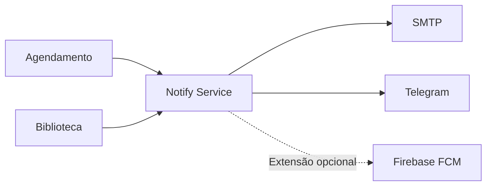
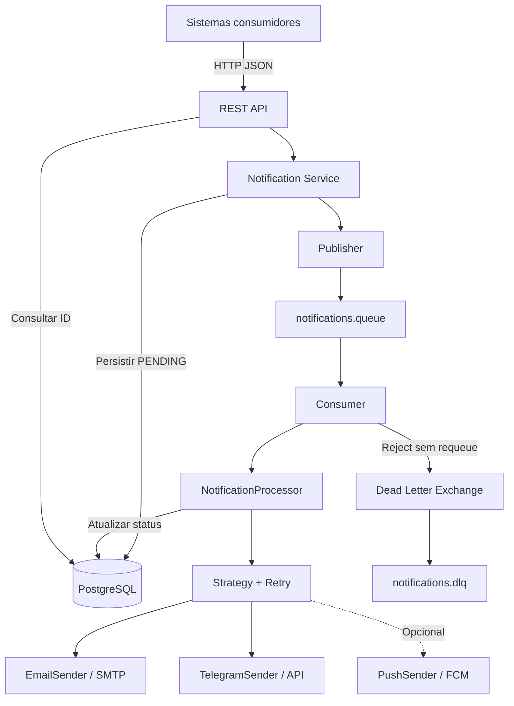
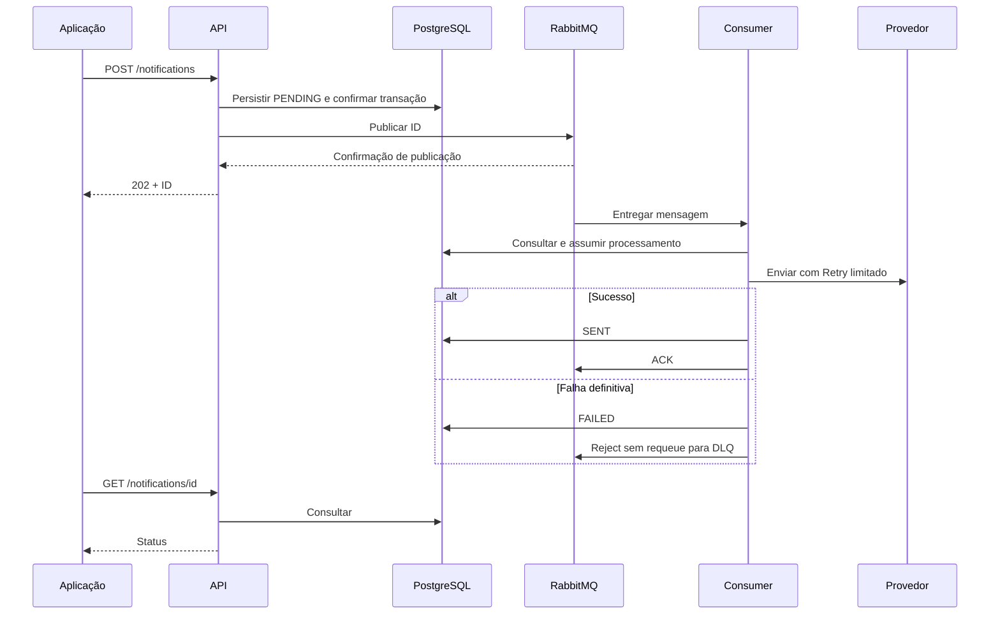
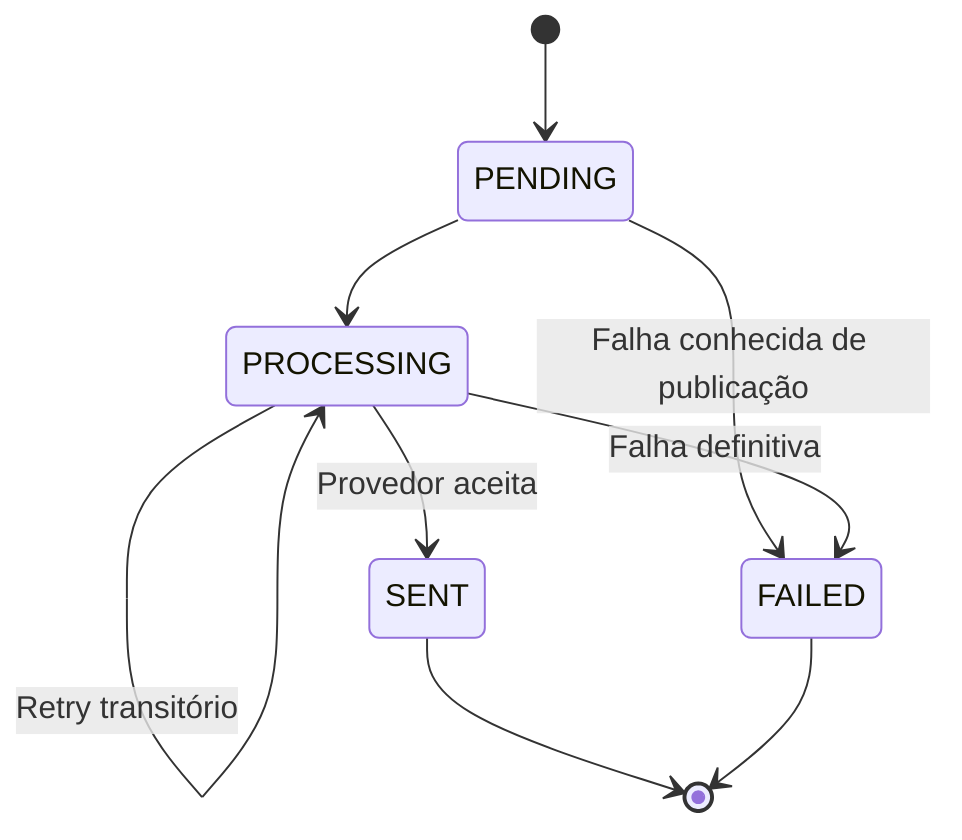
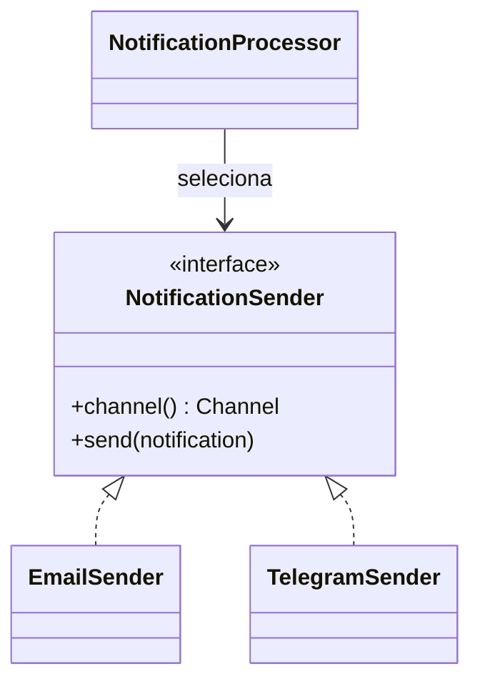
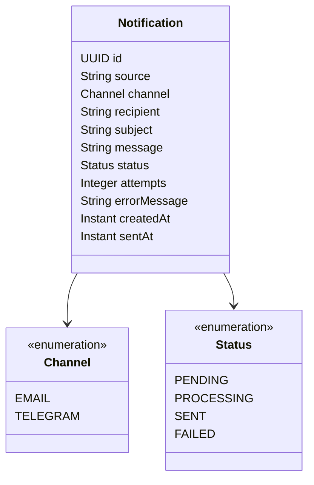
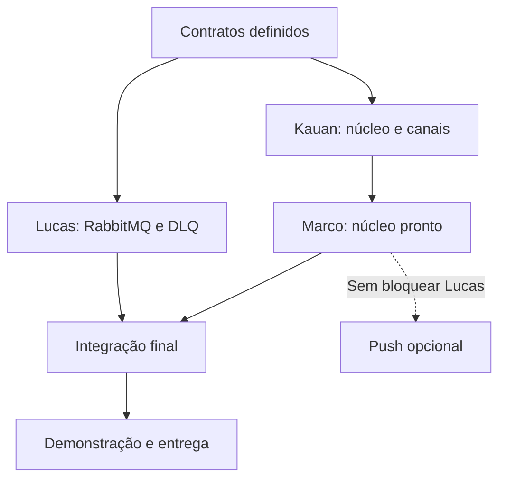

# Notify Service — Escopo reduzido e plano de desenvolvimento

> UFC Quixadá · Reuso de Software · Trabalho 2 — Desenvolvimento de Serviço Reutilizável
>
> Dupla: **Kauan e Lucas** | Entrega e apresentação: **27/11/2026**

## 1. Objetivo e decisão de escopo

Construir um microserviço reutilizável de envio de notificações multicanal, assíncrono, extensível e resiliente. Os sistemas consumidores decidem quando, por que e para quem notificar; o Notify Service decide como processar e enviar. Não há regras específicas dos domínios consumidores.

A prioridade é concluir o núcleo de Kauan hoje e disponibilizar os contratos para Lucas integrar RabbitMQ. Push é uma extensão opcional, nunca uma dependência da entrega principal. O objetivo acadêmico é demonstrar reuso e não construir uma plataforma comercial.



## 2. Escopo funcional obrigatório

| ID | Requisito | Aceitação |
|---|---|---|
| RF01 | Solicitar envio de notificação | Receber origem, canal, destinatário, assunto quando aplicável e mensagem pronta; validar, persistir e publicar para processamento assíncrono; retornar HTTP 202 com ID após aceitação. |
| RF02 | Consultar notificação | Consultar por ID, retornando status, tentativas, datas e motivo de falha quando aplicável. |

| Canal | Destinatário | Provedor | Prioridade |
|---|---|---|---|
| EMAIL | Endereço de e-mail | SMTP / Spring Mail | Obrigatório |
| TELEGRAM | Chat ID | Telegram Bot API | Obrigatório |
| PUSH | Token FCM | Firebase Admin SDK | Opcional |

O Telegram exige um bot configurado e um chat acessível ao bot. O conteúdo é preparado pelo sistema consumidor. Não há templates, variáveis ou listagem geral. O Retry integra RF01; a origem é um atributo, não um cadastro de clientes.

## 3. Requisitos de qualidade e arquitetura

| ID | Requisito | Solução |
|---|---|---|
| RNF01 | Interoperabilidade | REST e JSON |
| RNF02 | Extensibilidade | Strategy, Adapter, injeção de dependências |
| RNF03 | Resiliência | Retry limitado para falhas transitórias e DLQ |
| RNF04 | Desacoplamento temporal | RabbitMQ, uma fila principal |
| RNF05 | Rastreabilidade | PostgreSQL, status e tentativas |
| RNF06 | Confiabilidade | Fila durável, mensagens persistentes, confirmação de publicação, ACK e prevenção básica de duplicações |
| RNF07 | Portabilidade | Docker Compose |
| RNF08 | Documentação | Swagger/OpenAPI e README |
| RNF09 | Configurabilidade | Variáveis de ambiente e timeouts |

## 4. Arquitetura definitiva

Uma aplicação Spring Boot contém API, produtor, consumidor e processador compartilhado. PostgreSQL e RabbitMQ são infraestrutura externa. Não separar em múltiplos serviços.



### Fluxo de envio



### Mensageria

Uma fila durável `notifications.queue`, uma DLQ `notifications.dlq` e uma dead-letter exchange. Usar a exchange padrão para a fila principal ou uma exchange direta simples, conforme Lucas preferir. Mensagem interna contém somente `notificationId`; canal e conteúdo são recuperados do banco. Publicar depois do commit, verificar confirmação e roteamento antes de retornar 202. Falha conhecida de publicação: registrar FAILED e responder 503. Não fazer requeue infinito nem combinar retries independentes que multipliquem tentativas.

### Ciclo de vida



SENT significa aceitação pelo provedor, não leitura ou entrega final. Ignorar notificações já finalizadas e usar atualização condicional para assumir PENDING. Uma interrupção durante PROCESSING pode exigir recuperação manual; não prometer exactly-once. A persistência e a publicação não são atômicas: Transactional Outbox fica fora do escopo.

## 5. Padrões e contribuição acadêmica



| Conceito | Contribuição |
|---|---|
| Reuso de serviço | Mesma API e instância para diferentes domínios. |
| Strategy | Seleção de canal por contrato comum. |
| Adapter | Encapsula particularidades de SMTP e Telegram. A mesma classe pode exercer ambos os papéis. |
| Open/Closed e DIP | Processador depende de abstração; novo canal reaproveita o fluxo, com registro e validação próprios. |
| Retry | Até três tentativas totais para falhas transitórias, com espera limitada. Atende ao padrão de resiliência obrigatório. |
| DLQ | Isola falhas definitivas para inspeção. |
| Mensageria | Desacopla solicitação e envio. |
| Idempotência básica | Reduz reprocessamento, sem garantir envio exatamente uma vez. |

## 6. Stack

Java 21, Spring Boot 3.x, Spring Web, Validation, Spring Data JPA, PostgreSQL, Flyway, Spring AMQP, RabbitMQ, Spring Mail, RestClient, Resilience4j (Retry), Springdoc OpenAPI, Docker Compose, JUnit e Mockito. Firebase Admin SDK somente na extensão opcional. Fixar versões compatíveis; nunca versionar credenciais. Manter `.env.example` sem segredos.

## 7. API e modelagem

| Método | Endpoint | Resultado |
|---|---|---|
| POST | `/notifications` | 202 + ID e status inicial |
| GET | `/notifications/{id}` | 200 com detalhes ou 404 |

```json
{
  "source": "avante-agenda",
  "channel": "EMAIL",
  "recipient": "cliente@example.com",
  "subject": "Agendamento confirmado",
  "message": "Olá, Carlos! Seu horário é 14:00."
}
```

```json
{
  "id": "550e8400-e29b-41d4-a716-446655440000",
  "status": "PENDING"
}
```

Para Telegram, usar TELEGRAM e chat ID; assunto opcional. Validar entrada e canal antes de persistir; 400 para entrada inválida e 503 para indisponibilidade conhecida na aceitação. Não retornar erros internos brutos.



Uma entidade é suficiente. `attempts` conta chamadas efetivas ao provedor. Erros devem ser sanitizados. Não registrar segredos em logs.

## 8. Fora do escopo obrigatório

Push (opcional), parametrização e CRUD de templates, listagem geral, reenvio manual, Circuit Breaker, filas por canal, Outbox, autenticação, cadastro de clientes/dispositivos, painel administrativo, campanhas, agendamento, envio em massa, SMS, WhatsApp e webhooks. A API sem autenticação serve à demonstração local controlada; `source` não autentica nem isola clientes.

## 9. Contratos para colaboração

Kauan define `NotificationPublisher.publish(UUID id)` e `NotificationProcessor.process(UUID id)`. Lucas implementa o publisher RabbitMQ e o listener. O publisher deve sinalizar falha de publicação; o processador retorna resultado que distingue sucesso, já finalizado e falha definitiva, ou lança erro de infraestrutura. O listener confirma sucesso/já finalizado, rejeita falha definitiva para DLQ e trata falha de infraestrutura sem requeue infinito. A recuperação de PROCESSING após interrupção fica documentada como limitação.

Usar publisher fake somente em testes ou perfil local explicitamente identificado; nunca apresentar a simulação como mensageria real. Kauan testa o processador diretamente com estratégias fake e depois reais. Lucas pode testar listener com processador mockado. Compartilhar nomes, assinatura e comportamento antes de abrir branches.



## 10. Checklist progressivo e commits

Cada etapa abaixo é uma unidade pequena de trabalho. Dependências indicam pré-requisitos, não obrigam a seguir a numeração quando há trilhas paralelas. Commit somente após verificar o critério de conclusão. Os tempos são estimativas de esforço com assistência do Codex, não garantias.

### Etapa 01 — Definir escopo

- [x] Definir escopo

**Responsável:** Ambos  
**Dependências:** —  
**Implementação:** Consolidar esta proposta e alinhar cortes.  
**Critério de conclusão:** Escopo registrado; confirmação de Lucas ainda pendente.  
**Contribuição:** Evita expansão de escopo.  
**Commit sugerido:** `docs: define reduced project scope`

### Etapa 02 — Inicializar projeto

- [ ] Inicializar projeto

**Responsável:** Kauan  
**Dependências:** 01  
**Implementação:** Criar Spring Boot, dependências principais, Git e .gitignore.  
**Critério de conclusão:** Build e teste de contexto passam.  
**Contribuição:** Base executável.  
**Commit sugerido:** `chore: bootstrap notification service`

### Etapa 03 — Definir contratos compartilhados

- [ ] Definir contratos compartilhados

**Responsável:** Kauan  
**Dependências:** 02  
**Implementação:** Criar Channel, Status, interfaces NotificationPublisher, NotificationProcessor e NotificationSender; acordar resultado e exceções com Lucas.  
**Critério de conclusão:** Compila; Lucas recebe assinaturas e contrato de mensagem.  
**Contribuição:** Desacoplamento e trabalho paralelo.  
**Commit sugerido:** `feat: define notification contracts`

### Etapa 04 — Configurar banco

- [ ] Configurar banco

**Responsável:** Kauan  
**Dependências:** 02  
**Implementação:** Compose com PostgreSQL, configuração externa e Flyway.  
**Critério de conclusão:** Banco sobe e aplicação conecta.  
**Contribuição:** Portabilidade e persistência.  
**Commit sugerido:** `chore: configure postgres and flyway`

### Etapa 05 — Modelar persistência

- [ ] Modelar persistência

**Responsável:** Kauan  
**Dependências:** 03, 04  
**Implementação:** Criar Notification, migração, repository e atualização condicional de estado.  
**Critério de conclusão:** Persistência e consulta testadas.  
**Contribuição:** Rastreabilidade e prevenção básica de concorrência.  
**Commit sugerido:** `feat: persist notifications`

### Etapa 06 — Implementar solicitação

- [ ] Implementar solicitação

**Responsável:** Kauan  
**Dependências:** 05  
**Implementação:** DTO, validações, persistência antes da publicação, tratamento de falha e publisher mockado em teste.  
**Critério de conclusão:** Teste confirma PENDING, ID e chamada ao publisher.  
**Contribuição:** Núcleo do RF01.  
**Commit sugerido:** `feat: implement notification submission`

### Etapa 07 — Expor API

- [ ] Expor API

**Responsável:** Kauan  
**Dependências:** 06  
**Implementação:** POST e GET por ID, tratamento de 400/404/503, OpenAPI.  
**Critério de conclusão:** Testes HTTP passam e Swagger mostra dois endpoints.  
**Contribuição:** RF01/RF02 e interoperabilidade.  
**Commit sugerido:** `feat: expose notification rest api`

### Etapa 08 — Selecionar estratégias

- [ ] Selecionar estratégias

**Responsável:** Kauan  
**Dependências:** 03, 05  
**Implementação:** Registro de NotificationSender por canal via injeção; rejeitar canal sem implementação.  
**Critério de conclusão:** Teste seleciona estratégia correta.  
**Contribuição:** Strategy, DIP e extensibilidade.  
**Commit sugerido:** `feat: register channel strategies`

### Etapa 09 — Implementar processador

- [ ] Implementar processador

**Responsável:** Kauan  
**Dependências:** 08  
**Implementação:** Assumir PENDING condicionalmente, chamar estratégia, atualizar SENT/FAILED e ignorar estados finais; distinguir falha de infraestrutura.  
**Critério de conclusão:** Testes com sender fake cobrem sucesso, falha e redelivery finalizado.  
**Contribuição:** Fluxo compartilhado e idempotência básica.  
**Commit sugerido:** `feat: process notification lifecycle`

### Etapa 10 — Implementar e-mail

- [ ] Implementar e-mail

**Responsável:** Kauan  
**Dependências:** 08  
**Implementação:** Integrar Spring Mail, credenciais e timeouts externos.  
**Critério de conclusão:** Envio real aceito pelo SMTP; teste sem credenciais reais.  
**Contribuição:** Primeiro Adapter e canal funcional.  
**Commit sugerido:** `feat: integrate smtp sender`

### Etapa 11 — Implementar Telegram

- [ ] Implementar Telegram

**Responsável:** Kauan  
**Dependências:** 08  
**Implementação:** Integrar Bot API via RestClient, configurar token e timeout.  
**Critério de conclusão:** Mensagem real recebida no chat de teste.  
**Contribuição:** Segundo Adapter e demonstração de variabilidade.  
**Commit sugerido:** `feat: integrate telegram sender`

### Etapa 12 — Adicionar Retry

- [ ] Adicionar Retry

**Responsável:** Kauan  
**Dependências:** 09, 10, 11  
**Implementação:** Configurar Retry no envio; distinguir falhas transitórias de permanentes; contar tentativas efetivas.  
**Critério de conclusão:** Teste falha duas vezes e tem sucesso na terceira; erro permanente não repete.  
**Contribuição:** Resiliência exigida pelo professor.  
**Commit sugerido:** `feat: retry transient provider failures`

### Etapa 13 — Entregar núcleo a Lucas

- [ ] Entregar núcleo a Lucas

**Responsável:** Kauan  
**Dependências:** 07, 09, 10, 11, 12  
**Implementação:** Executar testes, publicar branch/PR, registrar configuração e contratos; informar limitações.  
**Critério de conclusão:** Lucas consegue integrar sem depender de mudanças no núcleo.  
**Contribuição:** Marco de conclusão da parte principal de Kauan.  
**Commit sugerido:** `docs: record core integration handoff`

### Etapa 14 — Configurar RabbitMQ

- [ ] Configurar RabbitMQ

**Responsável:** Lucas  
**Dependências:** 03  
**Implementação:** Adicionar broker ao Compose, Spring AMQP, fila durável e configuração externa.  
**Critério de conclusão:** Broker sobe e fila existe.  
**Contribuição:** Infraestrutura de assincronismo.  
**Commit sugerido:** `chore: configure rabbitmq`

### Etapa 15 — Implementar publisher

- [ ] Implementar publisher

**Responsável:** Lucas  
**Dependências:** 03, 14  
**Implementação:** Implementar contrato, mensagem com UUID, persistência e confirmação/roteamento.  
**Critério de conclusão:** Teste publica ID e detecta falha conhecida.  
**Contribuição:** Desacoplamento temporal.  
**Commit sugerido:** `feat: publish notification messages`

### Etapa 16 — Implementar listener e DLQ

- [ ] Implementar listener e DLQ

**Responsável:** Lucas  
**Dependências:** 03, 14  
**Implementação:** Consumir ID, chamar processador, ACK após resultado persistido; configurar dead-letter exchange e rejeição sem requeue.  
**Critério de conclusão:** Testes com mock verificam ACK e DLQ; sem loop infinito.  
**Contribuição:** Confiabilidade e tratamento de falhas.  
**Commit sugerido:** `feat: consume notifications and dead-letter failures`

### Etapa 17 — Integrar trilhas

- [ ] Integrar trilhas

**Responsável:** Ambos (Lucas lidera mensageria)  
**Dependências:** 13, 15, 16  
**Implementação:** Unir branches e executar fluxo real com banco e broker.  
**Critério de conclusão:** POST 202, GET SENT e falha definitiva na DLQ.  
**Contribuição:** Microserviço assíncrono completo.  
**Commit sugerido:** `test: verify end-to-end notification flow`

### Etapa 18 — Demonstrar reuso

- [ ] Demonstrar reuso

**Responsável:** Ambos  
**Dependências:** 17  
**Implementação:** Criar dois scripts simples: agendamento em Python e biblioteca em JavaScript, com mensagens prontas.  
**Critério de conclusão:** Ambos usam a mesma API e consultam status; sem alterar serviço.  
**Contribuição:** Reuso entre domínios e interoperabilidade.  
**Commit sugerido:** `docs: add reusable service examples`

### Etapa 19 — Finalizar README

- [ ] Finalizar README

**Responsável:** Lucas (Kauan revisa)  
**Dependências:** 17, 18  
**Implementação:** Documentar pré-requisitos, Compose, variáveis, Swagger, exemplos e limitações.  
**Critério de conclusão:** Outra pessoa consegue executar seguindo instruções.  
**Contribuição:** Facilidade de reuso.  
**Commit sugerido:** `docs: document setup and usage`

### Etapa 20 — Elaborar relatório

- [ ] Elaborar relatório

**Responsável:** Ambos  
**Dependências:** 01; finalizar após 17, 18  
**Implementação:** Escrever mínimo de seis páginas com arquitetura, padrões, demonstração e conclusão; iniciar texto em paralelo.  
**Critério de conclusão:** PDF revisado descreve somente o que foi implementado.  
**Contribuição:** Entrega acadêmica.  
**Commit sugerido:** `docs: add technical report`

### Etapa 21 — Preparar apresentação

- [ ] Preparar apresentação

**Responsável:** Ambos  
**Dependências:** 17, 18  
**Implementação:** Planejar demonstração de 10 minutos, ensaiar e guardar evidências de sucesso/falha.  
**Critério de conclusão:** Demonstração cabe no tempo.  
**Contribuição:** Comunicação das decisões e reuso.  
**Commit sugerido:** `docs: prepare presentation demo`

### Etapa 22 — Submeter trabalho

- [ ] Submeter trabalho

**Responsável:** Ambos  
**Dependências:** 19, 20, 21  
**Implementação:** Conferir GitHub, README, PDF, SIGAA quando aplicável e prazo de 27/11.  
**Critério de conclusão:** Entrega verificada e repositório sem segredos.  
**Contribuição:** Conclusão formal.  
**Commit sugerido:** `docs: finalize academic delivery`

## 11. Extensão opcional — Push (não bloqueia entrega)

Somente iniciar após etapa 13, se houver tempo sem comprometer integração, relatório ou apresentação. Trabalhar em branch `feat/push-notifications`. Lucas não precisa esperar por ela. Se não estiver estável, não integrar à versão entregue.

- [ ] **P01 — Configurar Firebase (Kauan).** Criar projeto e credenciais externas; obter token válido de um cliente Android de demonstração. Dependência: 13. Critério: token disponível e permissão de notificação concedida. Commit: `chore: configure optional firebase integration`.
- [ ] **P02 — Implementar PushSender (Kauan).** Adicionar SDK, canal PUSH, validação e estratégia; manter o mesmo publisher e fila. Dependência: P01. Critério: envio aceito pelo FCM. Contribuição: extensão sem alterar lógica central. Commit: `feat: add optional push sender`.
- [ ] **P03 — Validar e documentar (Kauan).** Confirmar recebimento real e regressão de e-mail/Telegram; atualizar documentação e integrar somente se estável. Dependência: P02. Commit: `test: verify push notification delivery`.

Um projeto Firebase é suficiente; o consumidor fornece token associado a esse projeto. Não criar cadastro de dispositivos. Push não é requisito para concluir o trabalho.

## 12. Divisão de responsabilidades e prioridades

Kauan concentra aproximadamente 75% do código (núcleo, persistência, API, canais e resiliência). Lucas concentra aproximadamente 25% (mensageria, DLQ e integração). A proporção é uma meta de distribuição, não uma medição de linhas de código. Ambos participam da entrega acadêmica. Se Lucas atrasar, Kauan pode assumir a configuração ou publisher, comunicando a mudança para evitar duplicação.

**Meta de hoje:** concluir etapas 02–13. A etapa 03 libera Lucas imediatamente; não é necessário esperar a etapa 13 para começar RabbitMQ. A estimativa anterior para a parte principal de Kauan foi de 3–5 horas de código assistido, mas integrações externas e depuração podem aumentar esse prazo. Não sacrificar testes essenciais nem a entrega acadêmica para cumprir essa estimativa.

## 13. Testes e demonstração mínima

| Cenário | Resultado esperado |
|---|---|
| E-mail válido | 202, depois SENT e envio real |
| Telegram válido | 202, depois SENT e mensagem no chat |
| ID inexistente | 404 |
| Entrada inválida | 400 sem publicar |
| Falha transitória simulada | Retry limitado e sucesso quando recupera |
| Falha permanente | FAILED, sem retry indevido, mensagem na DLQ |
| Redelivery de SENT | Não repetir envio |
| Broker indisponível | Não retornar 202 em falha conhecida |

Usar mocks para provocar falhas determinísticas, deixando claro quando a demonstração é simulada. Testar pelo menos um fluxo real por canal obrigatório. Não incluir dados pessoais reais nas evidências.

## 14. Relatório e apresentação

Relatório mínimo de seis páginas: introdução e abordagem de serviço reutilizável; descrição da solução; arquitetura e tecnologias; padrões de reuso e resiliência; demonstração em dois contextos; conclusão, benefícios e limitações. Diagramas deste arquivo podem ser reaproveitados, ajustados ao código efetivamente entregue.

Apresentação de dez minutos: 1 min de problema e objetivo; 2 min de arquitetura; 2 min de padrões; 3 min de demonstração de dois consumidores; 1 min de falha/Retry/DLQ; 1 min de conclusão. Preparar evidências locais caso um provedor externo esteja indisponível.

## 15. Referência e critério de entrega

Enunciado: Trabalho 2 — Desenvolvimento de Serviço Reutilizável, QXD0068, UFC Quixadá, professor Francisco Victor da Silva Pinheiro. Exige serviço genérico, API documentada, ao menos um padrão de resiliência, demonstração de reuso, código no GitHub com README, relatório PDF de no mínimo seis páginas e apresentação de dez minutos por dupla. Entrega e apresentação em 27/11/2026. RabbitMQ, PostgreSQL, canais e padrões adicionais são decisões da dupla, não exigências específicas do enunciado.
