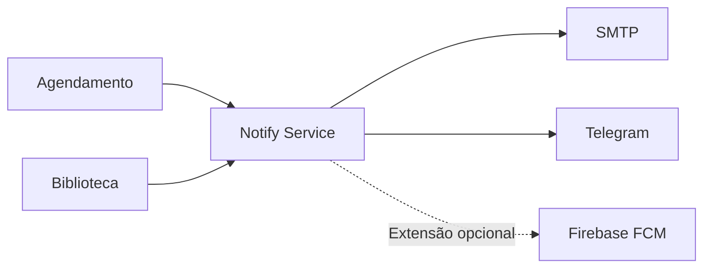
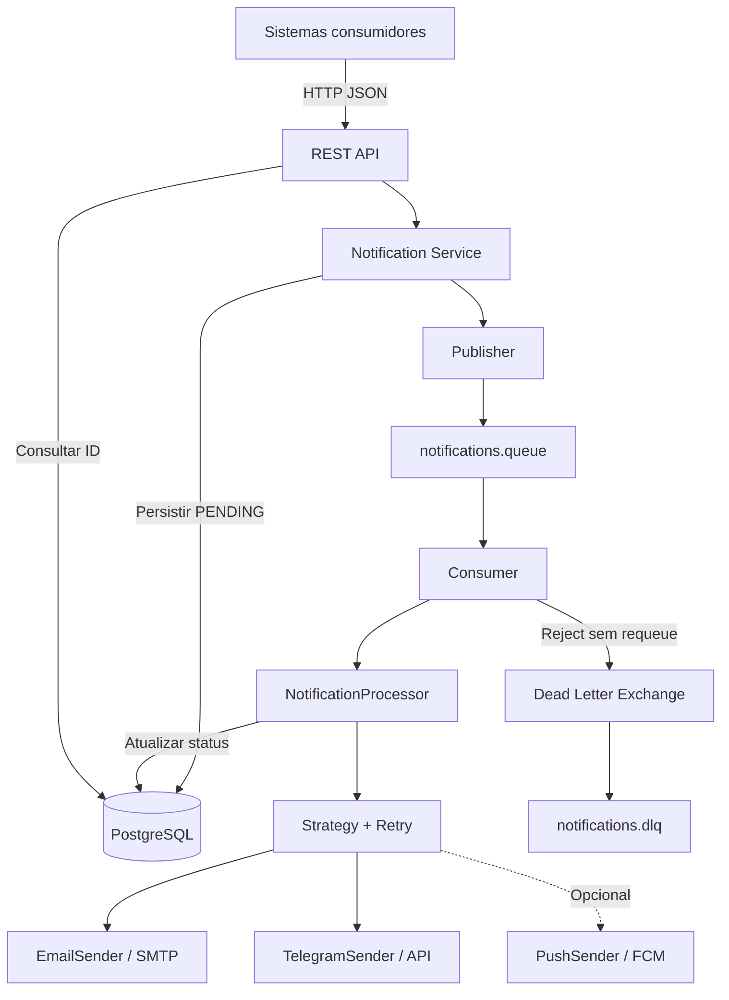
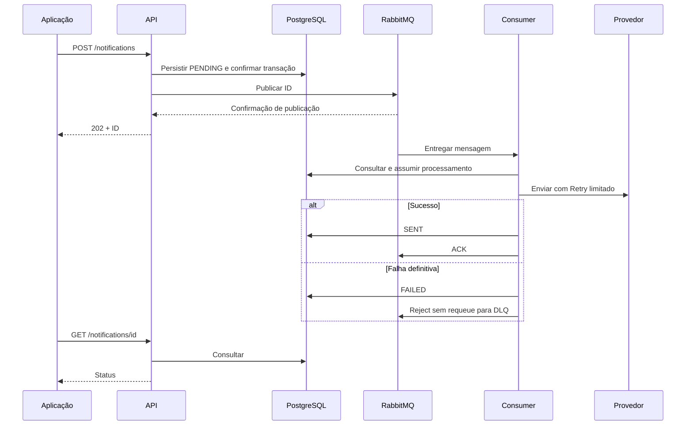
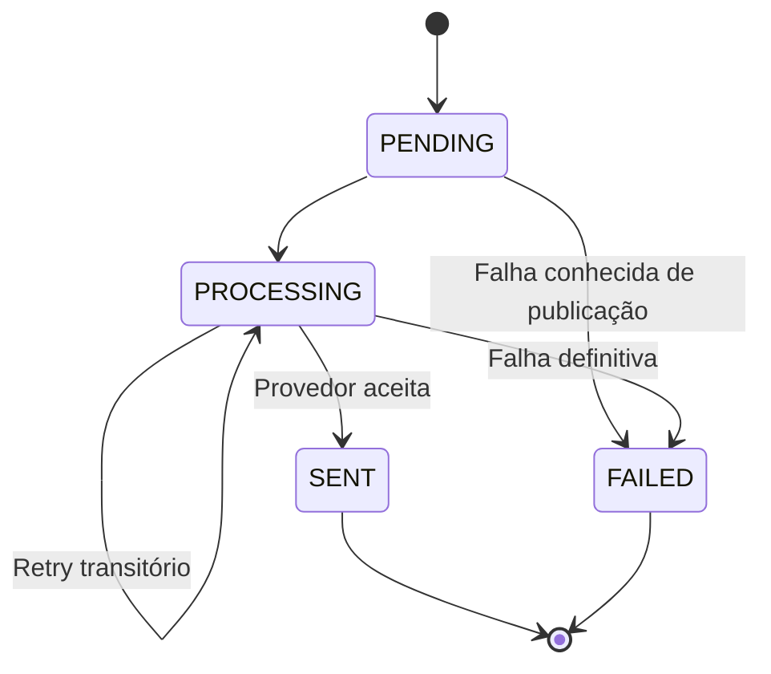
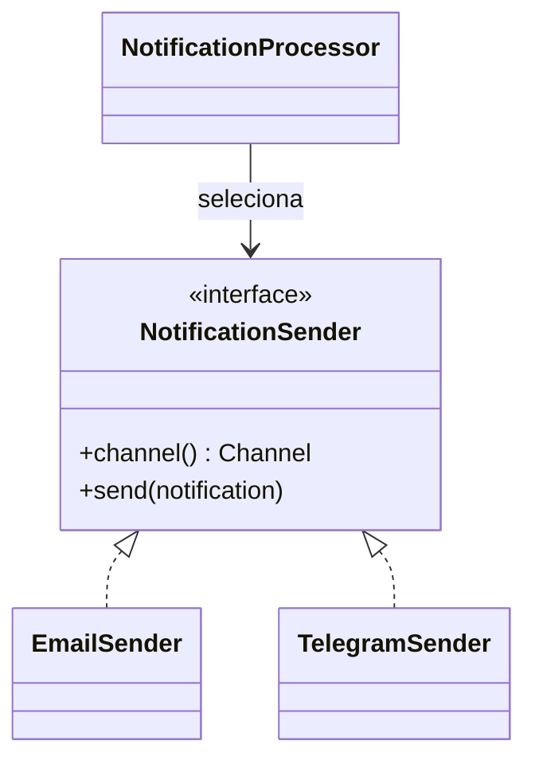
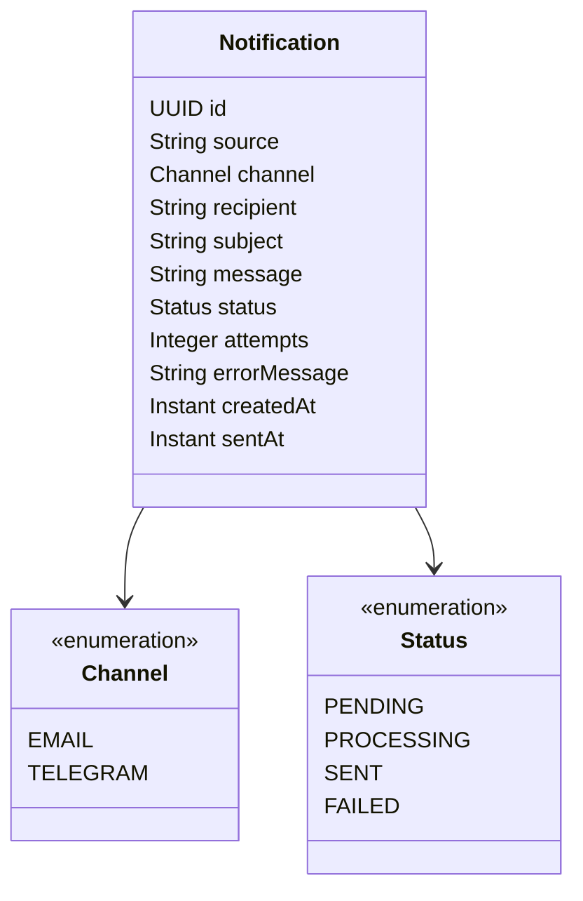
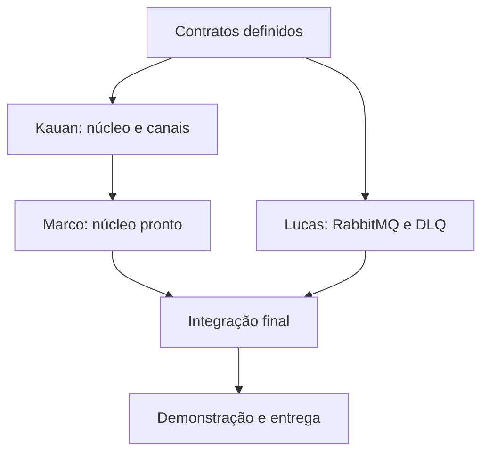

# Notify Service — Escopo reduzido e plano de desenvolvimento

> UFC Quixadá · Reuso de Software · Trabalho 2 — Desenvolvimento de Serviço Reutilizável
>
> Dupla: **Kauan e Lucas** | Entrega e apresentação: **27/11/2026**

## 1. Objetivo e decisão de escopo

Construir um microserviço reutilizável de envio de notificações multicanal, assíncrono, extensível e resiliente. Os sistemas consumidores decidem quando, por que e para quem notificar; o Notify Service decide como processar e enviar. Não há regras específicas dos domínios consumidores.

Em **26/11**, a meta de Kauan é concluir e disponibilizar o núcleo com API, persistência, e-mail, Telegram e Retry. Lucas pode avançar na mensageria assim que receber os contratos da etapa 03. O [roteiro do dia](#12-divisão-de-responsabilidades-e-prioridades) define o que encerrar em cada frente.

### Ponto de partida em 26/11

| Já está na `main` | O que falta para o escopo final |
|---|---|
| Lucas criou a aplicação Java 21 com Spring Boot e Maven no commit `d6319cb`. | Adicionar as dependências do núcleo e verificar a execução pelo Maven Wrapper. |
| Lucas implementou o envio por Spring Mail, com validação do e-mail e configuração de SMTP, no commit `7c83d0d`. | Kauan adapta o sender existente à estratégia EMAIL e valida o envio com SMTP de teste. |
| O mesmo commit adicionou Spring AMQP, o listener, duas filas duráveis e a rejeição sem requeue por padrão. Hoje o listener recebe o e-mail completo em `notifications.email` e chama o sender diretamente. | Lucas reaproveita a configuração, adapta o listener ao fluxo por ID, implementa o publisher e verifica ACK e DLQ no broker. |
| O [README atual](../notificator.service/README.md) documenta o envio direto via RabbitMQ com Mailpit. | Lucas atualiza o README para a API após a integração. |

Os seis casos existentes passaram em execução direta pelo JUnit com SMTP mockado. Na verificação local, o Surefire bloqueou a execução usual pelo Maven e o acesso ao Docker impediu o teste com broker real.



## 2. Escopo funcional obrigatório

| ID | Requisito | Aceitação |
|---|---|---|
| RF01 | Solicitar envio de notificação | Receber origem, canal, destinatário, assunto quando aplicável e mensagem pronta; validar, persistir e publicar para processamento assíncrono; retornar HTTP 202 com ID após aceitação. |
| RF02 | Consultar notificação | Consultar por ID, retornando status, tentativas, datas e motivo de falha quando aplicável. |

| Canal | Destinatário | Provedor | Prioridade |
|---|---|---|---|
| EMAIL | Endereço de e-mail | SMTP / Spring Mail | Obrigatório |
| TELEGRAM | Chat ID | Telegram Bot API | Obrigatório |
| PUSH | Token FCM | Firebase Admin SDK | Opcional |

O Telegram exige um bot configurado e um chat acessível ao bot. O conteúdo é preparado pelo sistema consumidor. Não há templates, variáveis ou listagem geral. O Retry integra RF01; a origem é um atributo, não um cadastro de clientes.

## 3. Requisitos de qualidade e arquitetura

| ID | Requisito | Solução |
|---|---|---|
| RNF01 | Interoperabilidade | REST e JSON |
| RNF02 | Extensibilidade | Strategy, Adapter, injeção de dependências |
| RNF03 | Resiliência | Retry limitado para falhas transitórias e DLQ |
| RNF04 | Desacoplamento temporal | RabbitMQ, uma fila principal |
| RNF05 | Rastreabilidade | PostgreSQL, status e tentativas |
| RNF06 | Confiabilidade | Fila durável, mensagens persistentes, confirmação de publicação, ACK e prevenção básica de duplicações |
| RNF07 | Portabilidade | Docker Compose |
| RNF08 | Documentação | Swagger/OpenAPI e README |
| RNF09 | Configurabilidade | Variáveis de ambiente e timeouts |

## 4. Arquitetura-alvo

Uma aplicação Spring Boot contém API, produtor, consumidor e processador compartilhado. PostgreSQL e RabbitMQ são infraestrutura externa. Não separar em múltiplos serviços.



### Fluxo de envio



### Mensageria

Uma fila durável `notifications.queue`, uma DLQ `notifications.dlq` e uma dead-letter exchange. Usar a exchange padrão para a fila principal ou uma exchange direta simples, conforme Lucas preferir. Mensagem interna contém somente `notificationId`; canal e conteúdo são recuperados do banco. Publicar depois do commit, verificar confirmação e roteamento antes de retornar 202. Falha conhecida de publicação: registrar FAILED e responder 503. Não fazer requeue infinito nem combinar retries independentes que multipliquem tentativas.

### Ciclo de vida



SENT significa aceitação pelo provedor, não leitura ou entrega final. Ignorar notificações já finalizadas e usar atualização condicional para assumir PENDING. Uma interrupção durante PROCESSING pode exigir recuperação manual; não prometer exactly-once. A persistência e a publicação não são atômicas: Transactional Outbox fica fora do escopo.

## 5. Padrões e contribuição acadêmica



| Conceito | Contribuição |
|---|---|
| Reuso de serviço | Mesma API e instância para diferentes domínios. |
| Strategy | Seleção de canal por contrato comum. |
| Adapter | Encapsula particularidades de SMTP e Telegram. A mesma classe pode exercer ambos os papéis. |
| Open/Closed e DIP | Processador depende de abstração; novo canal reaproveita o fluxo, com registro e validação próprios. |
| Retry | Até três tentativas totais para falhas transitórias, com espera limitada. Atende ao padrão de resiliência obrigatório. |
| DLQ | Isola falhas definitivas para inspeção. |
| Mensageria | Desacopla solicitação e envio. |
| Idempotência básica | Reduz reprocessamento, sem garantir envio exatamente uma vez. |

## 6. Stack

A base usa Java 21, Maven, Spring Mail, Spring AMQP e Jackson. O [POM atual](../notificator.service/pom.xml) declara Spring Boot 4.2.0. Usar essa base como ponto de partida e conferir a compatibilidade ao adicionar Spring Web, Validation, Spring Data JPA, PostgreSQL, Flyway, RestClient, Resilience4j (Retry) e Springdoc OpenAPI. O fluxo final será executado com Docker Compose e testado com JUnit e Mockito. Manter `.env.example` com valores de exemplo e fornecer credenciais pelo ambiente. O Firebase Admin SDK pertence à extensão opcional.

## 7. API e modelagem

| Método | Endpoint | Resultado |
|---|---|---|
| POST | `/notifications` | 202 + ID e status inicial |
| GET | `/notifications/{id}` | 200 com detalhes ou 404 |

```json
{
  "source": "avante-agenda",
  "channel": "EMAIL",
  "recipient": "cliente@example.com",
  "subject": "Agendamento confirmado",
  "message": "Olá, Carlos! Seu horário é 14:00."
}
```

```json
{
  "id": "550e8400-e29b-41d4-a716-446655440000",
  "status": "PENDING"
}
```

Para Telegram, usar TELEGRAM e chat ID; assunto opcional. Validar entrada e canal antes de persistir; 400 para entrada inválida e 503 para indisponibilidade conhecida na aceitação. Não retornar erros internos brutos.



Uma entidade é suficiente. `attempts` conta chamadas efetivas ao provedor. Erros devem ser sanitizados. Não registrar segredos em logs.

## 8. Fora do escopo obrigatório

Push (opcional), parametrização e CRUD de templates, listagem geral, reenvio manual, Circuit Breaker, filas por canal, Outbox, autenticação, cadastro de clientes/dispositivos, painel administrativo, campanhas, agendamento, envio em massa, SMS, WhatsApp e webhooks. A API sem autenticação serve à demonstração local controlada; `source` não autentica nem isola clientes.

## 9. Contratos para colaboração

Kauan publica um primeiro commit ou PR com as assinaturas e o resultado do processador assim que a etapa 03 compilar. Lucas usa esse contrato para implementar a mensageria em paralelo.

| Contrato | Kauan | Lucas |
|---|---|---|
| `NotificationPublisher.publish(UUID id)` | Persiste e confirma a transação antes de publicar. Trata `NotificationPublicationException` com FAILED e HTTP 503. | Usa `NotificationMessage` para publicar JSON com o campo `notificationId` em formato UUID. Retorna após confirmação e roteamento. Lança a exceção do contrato em falhas conhecidas. |
| `NotificationProcessor.process(UUID id)` | Busca a notificação, assume o processamento, executa o sender e persiste o estado. Retorna `ProcessingResult` ou lança `NotificationProcessingException` em falha de infraestrutura. | Adapta o listener para chamar o processador e usa o resultado para decidir ACK ou rejeição. |
| `NotificationSender` | Adapta o sender SMTP e implementa o sender Telegram. Cada sender declara seu `Channel` e recebe um `NotificationContent` com destinatário, assunto e mensagem. | Valida a integração através do processador e da fila. |

Uma confirmação de publicação inconclusiva deixa a aceitação incerta. A exceção de publicação acima representa uma falha conhecida.

| Resultado do processador | Ação do listener |
|---|---|
| `SENT`, `ALREADY_FINALIZED` | Confirmar a entrega. |
| `FAILED` | Rejeitar sem requeue e encaminhar à DLQ. |
| `ALREADY_PROCESSING` | Proposta para alinhar com Lucas. Confirmar a entrega repetida sem assumir o processamento. |
| `NOT_FOUND` | Proposta para alinhar com Lucas. Rejeitar sem requeue e encaminhar à DLQ para inspeção. |
| `NotificationProcessingException` | Alinhar com Lucas a política de infraestrutura. A proposta inicial é encaminhar à DLQ sem requeue. |

A recuperação de PROCESSING após interrupção fica documentada como limitação. Kauan valida API e processador com publisher mockado e PostgreSQL. Lucas valida o listener com processador mockado e verifica ACK e DLQ com o broker real.



## 10. Checklist progressivo e commits

As dependências indicam pré-requisitos. As duas frentes podem avançar em paralelo após o contrato da etapa 03. Marcar cada etapa concluída depois de verificar o seu critério.

### Etapa 01 — Definir escopo

- [x] Definir escopo

**Responsável:** Ambos  
**Dependências:** Nenhuma.  
**Implementação:** Consolidar esta proposta e alinhar cortes.  
**Critério de conclusão:** Escopo registrado; confirmação de Lucas ainda pendente.  
**Contribuição:** Evita expansão de escopo.  
**Commit sugerido:** `docs: define reduced project scope`

### Etapa 02 — Base do projeto

- [x] Inicializar projeto

**Responsável:** Lucas  
**Entregue:** Bootstrap no commit `d6319cb`, com Spring Boot, Java 21, Maven Wrapper e estrutura inicial do serviço.  
**Verificação:** A compilação e a inicialização do contexto foram verificadas com a suíte de testes existente. A execução pelo Maven Wrapper volta a ser verificada no fechamento da etapa 13.  
**Contribuição:** Base para as duas frentes.

### Etapa 03 — Definir contratos compartilhados

- [x] Definir e compilar os contratos compartilhados
- [ ] Alinhar com Lucas as decisões em aberto de ACK e DLQ

**Responsável:** Kauan  
**Dependências:** 02  
**Implementação:** Criar `Channel`, `Status` e os contratos `NotificationPublisher`, `NotificationProcessor` e `NotificationSender`. Acordar com Lucas o resultado de processamento, as exceções e a mensagem contendo o UUID.  
**Critério de conclusão:** O commit ou PR dos contratos compila e está disponível para Lucas iniciar as etapas 15 e 16.  
**Contribuição:** Desacoplamento e trabalho paralelo.  
**Commit sugerido:** `feat: define notification contracts`

### Etapa 04 — Configurar banco

- [ ] Configurar banco

**Responsável:** Kauan  
**Dependências:** 02  
**Implementação:** Criar o Compose com PostgreSQL e configurar datasource e Flyway. Compartilhar o Compose inicial para Lucas acrescentar o RabbitMQ na etapa 14.  
**Critério de conclusão:** Banco sobe e aplicação conecta.  
**Contribuição:** Portabilidade e persistência.  
**Commit sugerido:** `chore: configure postgres and flyway`

### Etapa 05 — Modelar persistência

- [ ] Modelar persistência

**Responsável:** Kauan  
**Dependências:** 03, 04  
**Implementação:** Criar Notification, migração, repository e atualização condicional de estado.  
**Critério de conclusão:** Persistência e consulta testadas.  
**Contribuição:** Rastreabilidade e prevenção básica de concorrência.  
**Commit sugerido:** `feat: persist notifications`

### Etapa 06 — Implementar solicitação

- [ ] Implementar solicitação

**Responsável:** Kauan  
**Dependências:** 05  
**Implementação:** DTO, validações, persistência antes da publicação, tratamento de falha e publisher mockado em teste.  
**Critério de conclusão:** Testes confirmam que PENDING existe antes da publicação e que uma falha conhecida do publisher grava FAILED.  
**Contribuição:** Núcleo do RF01.  
**Commit sugerido:** `feat: implement notification submission`

### Etapa 07 — Expor API

- [ ] Expor API

**Responsável:** Kauan  
**Dependências:** 06  
**Implementação:** POST e GET por ID, tratamento de 400/404/503, OpenAPI.  
**Critério de conclusão:** Testes HTTP cobrem 202, consulta por ID, 400, 404 e 503 com publisher mockado. Os dois endpoints aparecem no Swagger.  
**Contribuição:** RF01/RF02 e interoperabilidade.  
**Commit sugerido:** `feat: expose notification rest api`

### Etapa 08 — Selecionar estratégias

- [ ] Selecionar estratégias

**Responsável:** Kauan  
**Dependências:** 03, 05  
**Implementação:** Registro de NotificationSender por canal via injeção; rejeitar canal sem implementação.  
**Critério de conclusão:** Teste seleciona estratégia correta.  
**Contribuição:** Strategy, DIP e extensibilidade.  
**Commit sugerido:** `feat: register channel strategies`

### Etapa 09 — Implementar processador

- [ ] Implementar processador

**Responsável:** Kauan  
**Dependências:** 08  
**Implementação:** Assumir PENDING condicionalmente, chamar estratégia, atualizar SENT/FAILED e ignorar estados finais; distinguir falha de infraestrutura.  
**Critério de conclusão:** Testes com sender fake cobrem sucesso, falha e redelivery finalizado.  
**Contribuição:** Fluxo compartilhado e idempotência básica.  
**Commit sugerido:** `feat: process notification lifecycle`

### Etapa 10 — Adaptar o sender de e-mail

- [x] Implementar o sender SMTP e os testes do fluxo original (Lucas, `7c83d0d`)
- [ ] Integrar o sender ao núcleo e verificar SMTP (Kauan)

**Responsável:** Kauan  
**Dependências:** 08  
**Implementação:** Adaptar `EmailNotificationSender` ao contrato `NotificationSender` para EMAIL. Mapear destinatário, assunto e mensagem da notificação persistida e reaproveitar a montagem MIME, a validação e a configuração SMTP existentes. Atualizar os testes afetados pela adaptação.  
**Critério de conclusão:** O processador seleciona EMAIL, o sender envia com a configuração externa e o e-mail aparece no Mailpit ou em outro SMTP de teste. A suíte automatizada executa com SMTP mockado.  
**Contribuição:** Primeiro Adapter e canal funcional.  
**Commit sugerido:** `feat: adapt smtp sender to notification strategy`

### Etapa 11 — Implementar Telegram

- [ ] Implementar Telegram

**Responsável:** Kauan  
**Dependências:** 08  
**Implementação:** Preparar o bot e o chat de teste no início do dia. Integrar a Bot API via RestClient, com token e timeout configurados pelo ambiente.  
**Critério de conclusão:** O processador seleciona TELEGRAM e a mensagem chega ao chat de teste.  
**Contribuição:** Segundo Adapter e demonstração de variabilidade.  
**Commit sugerido:** `feat: integrate telegram sender`

### Etapa 12 — Adicionar Retry

- [ ] Adicionar Retry

**Responsável:** Kauan  
**Dependências:** 09, 10, 11  
**Implementação:** Configurar Retry no envio; distinguir falhas transitórias de permanentes; contar tentativas efetivas.  
**Critério de conclusão:** Uma falha transitória simulada seguida de sucesso na terceira tentativa grava SENT com três tentativas. Uma falha permanente grava FAILED após a primeira chamada.  
**Contribuição:** Resiliência exigida pelo professor.  
**Commit sugerido:** `feat: retry transient provider failures`

### Etapa 13 — Entregar núcleo a Lucas

- [ ] Entregar núcleo a Lucas

**Responsável:** Kauan  
**Dependências:** 07, 09, 10, 11, 12  
**Implementação:** Executar o build e a suíte, publicar a branch ou PR e registrar as variáveis de ambiente, os contratos e a evidência de cada canal.  
**Critério de conclusão:** O build e a suíte passam. Com PostgreSQL e publisher mockado, o teste aceita uma solicitação, aciona o processador pelo ID e consulta o status final. Os critérios de SMTP, Telegram e Retry foram verificados. Lucas tem acesso à branch ou ao PR, à configuração e às evidências.  
**Contribuição:** Marco de conclusão da parte individual de Kauan. O fluxo de ponta a ponta com broker real é verificado na etapa 17.  
**Commit sugerido:** `docs: record core integration handoff`

### Etapa 14 — Completar a configuração do RabbitMQ

- [x] Adicionar Spring AMQP e configuração inicial de filas (Lucas, `7c83d0d`)
- [ ] Subir o broker pelo Compose e verificar as filas

**Responsável:** Lucas  
**Dependências:** Compose inicial da etapa 04 para acrescentar o serviço.  
**Implementação:** Acrescentar RabbitMQ ao Compose, reaproveitar a configuração AMQP e ajustar os nomes e o roteamento das filas conforme a seção 4. A configuração do broker pode ser preparada com a base atual.  
**Critério de conclusão:** O broker sobe pelo Compose e as filas duráveis previstas são declaradas.  
**Contribuição:** Infraestrutura de assincronismo.  
**Commit sugerido:** `chore: configure rabbitmq`

### Etapa 15 — Implementar publisher

- [ ] Implementar publisher

**Responsável:** Lucas  
**Dependências:** 03 para implementar. 14 para validar com o broker.  
**Implementação:** Implementar o contrato, publicar mensagem persistente com UUID e verificar confirmação e roteamento.  
**Critério de conclusão:** Teste verifica a publicação do ID e que o publisher sinaliza falha conhecida de aceitação ou de roteamento.  
**Contribuição:** Desacoplamento temporal.  
**Commit sugerido:** `feat: publish notification messages`

### Etapa 16 — Adaptar listener e DLQ

- [x] Adicionar listener de e-mail e fila de falhas do fluxo original (Lucas, `7c83d0d`)
- [ ] Integrar o listener por ID ao processador e verificar ACK e DLQ

**Responsável:** Lucas  
**Dependências:** 03 para implementar. 14 para validar com o broker.  
**Implementação:** Adaptar o listener existente para consumir o UUID e chamar o processador. Usar o resultado para confirmar ou rejeitar a entrega conforme a seção 9.  
**Critério de conclusão:** Testes com processador mockado verificam a decisão de ACK ou rejeição. Com broker real, a falha definitiva chega à DLQ sem loop de requeue.  
**Contribuição:** Confiabilidade e tratamento de falhas.  
**Commit sugerido:** `feat: consume notifications and dead-letter failures`

### Etapa 17 — Integrar trilhas

- [ ] Integrar trilhas

**Responsável:** Ambos (Lucas lidera mensageria)  
**Dependências:** 13, 15, 16  
**Implementação:** Unir branches e executar fluxo real com banco e broker.  
**Critério de conclusão:** POST 202 e GET SENT para cada canal obrigatório. Falha definitiva resulta em GET FAILED e mensagem na DLQ.  
**Contribuição:** Microserviço assíncrono completo.  
**Commit sugerido:** `test: verify end-to-end notification flow`

### Etapa 18 — Demonstrar reuso

- [ ] Demonstrar reuso

**Responsável:** Ambos  
**Dependências:** API definida na seção 7 para preparar os exemplos. Etapa 17 para validar a demonstração.  
**Implementação:** Criar um script de agendamento em Python e um de biblioteca em JavaScript. Cada script envia sua mensagem e consulta o status na mesma API.  
**Critério de conclusão:** Ambos usam a mesma API e consultam status; sem alterar serviço.  
**Contribuição:** Reuso entre domínios e interoperabilidade.  
**Commit sugerido:** `docs: add reusable service examples`

### Etapa 19 — Finalizar README

- [ ] Finalizar README

**Responsável:** Lucas (Kauan revisa)  
**Dependências:** 17, 18  
**Implementação:** Atualizar o README existente com pré-requisitos, Compose, variáveis, Swagger, exemplos da API e limitações.  
**Critério de conclusão:** Outra pessoa consegue executar seguindo instruções.  
**Contribuição:** Facilidade de reuso.  
**Commit sugerido:** `docs: document setup and usage`

### Etapa 20 — Elaborar relatório

- [ ] Elaborar relatório

**Responsável:** Ambos  
**Dependências:** 01; finalizar após 17, 18  
**Implementação:** Escrever mínimo de seis páginas com arquitetura, padrões, demonstração e conclusão; iniciar texto em paralelo.  
**Critério de conclusão:** PDF revisado descreve somente o que foi implementado.  
**Contribuição:** Entrega acadêmica.  
**Commit sugerido:** `docs: add technical report`

### Etapa 21 — Preparar apresentação

- [ ] Preparar apresentação

**Responsável:** Ambos  
**Dependências:** 17, 18  
**Implementação:** Planejar demonstração de 10 minutos, ensaiar e guardar evidências de sucesso/falha.  
**Critério de conclusão:** Demonstração cabe no tempo.  
**Contribuição:** Comunicação das decisões e reuso.  
**Commit sugerido:** `docs: prepare presentation demo`

### Etapa 22 — Submeter trabalho

- [ ] Submeter trabalho

**Responsável:** Ambos  
**Dependências:** 19, 20, 21  
**Implementação:** Conferir GitHub, README, PDF, SIGAA quando aplicável e prazo de 27/11.  
**Critério de conclusão:** Entrega verificada e repositório sem segredos.  
**Contribuição:** Conclusão formal.  
**Commit sugerido:** `docs: finalize academic delivery`

## 11. Extensão opcional — Push

Reavaliar Push depois de preparar a entrega obrigatória. Se houver tempo para a extensão, trabalhar em branch `feat/push-notifications` e integrar somente após validar a regressão dos canais obrigatórios.

- [ ] **P01 — Configurar Firebase (Kauan).** Criar projeto e credenciais externas e obter token válido de um cliente Android de demonstração. Dependência: preparação da entrega obrigatória. Critério: token disponível e permissão de notificação concedida. Commit: `chore: configure optional firebase integration`.
- [ ] **P02 — Implementar PushSender (Kauan).** Adicionar SDK, canal PUSH, validação e estratégia; manter o mesmo publisher e fila. Dependência: P01. Critério: envio aceito pelo FCM. Contribuição: extensão sem alterar lógica central. Commit: `feat: add optional push sender`.
- [ ] **P03 — Validar e documentar (Kauan).** Confirmar recebimento real e regressão de e-mail/Telegram; atualizar documentação e integrar somente se estável. Dependência: P02. Commit: `test: verify push notification delivery`.

Um projeto Firebase é suficiente; o consumidor fornece token associado a esse projeto. Não criar cadastro de dispositivos. Push não é requisito para concluir o trabalho.

## 12. Divisão de responsabilidades e prioridades

| Responsável | Entrega | Etapas |
|---|---|---|
| **Kauan** | Contratos, Compose inicial com PostgreSQL, persistência, API, processador, adaptação do SMTP, Telegram, Retry e entrega do núcleo testado. | 03–13 |
| **Lucas** | Completar o Compose com RabbitMQ, configurar as filas, implementar o publisher, adaptar o listener, verificar ACK e DLQ e manter o README de execução. | 14–16, 19 |
| **Kauan e Lucas** | Integrar o fluxo com o broker real, demonstrar reuso em dois contextos e preparar o relatório, a apresentação e a submissão. Lucas lidera a verificação da mensageria. | 17–18, 20–22 |

### Roteiro de Kauan para 26/11

1. **Liberar Lucas.** Publicar os contratos da etapa 03 assim que compilarem. No início do dia, verificar acesso ao PostgreSQL, ao SMTP de teste e ao bot e chat do Telegram.
2. **Fechar o núcleo.** Fazer as etapas 04–09. Publicar o Compose inicial assim que o PostgreSQL subir. Verificar criação, consulta e transição de status com publisher e sender de teste.
3. **Validar EMAIL primeiro.** Adaptar o sender existente e confirmar o recebimento no SMTP de teste (etapa 10). Esse é o primeiro caminho do núcleo com um provedor real.
4. **Completar TELEGRAM e Retry.** Validar o envio no chat e a contagem de tentativas nos testes de falhas transitória e permanente (etapas 11–12).
5. **Entregar a branch ou o PR.** Rodar a verificação da etapa 13 e registrar como executar o núcleo, quais variáveis configurar e quais testes passaram. Se uma verificação externa ficar pendente, compartilhar a branch para Lucas avançar e registrar o teste pendente no checklist.

A parte individual de Kauan termina na etapa 13, com os dois canais verificados diretamente pelo processador. A etapa 17 valida o mesmo caminho de ponta a ponta com publisher, broker e listener reais. Relatório e exemplos de reuso podem começar em paralelo, com a revisão final após a integração.

## 13. Testes e demonstração mínima

| Cenário | Resultado esperado |
|---|---|
| E-mail válido | 202, depois SENT e envio real |
| Telegram válido | 202, depois SENT e mensagem no chat |
| ID inexistente | 404 |
| Entrada inválida | 400 sem publicar |
| Falha transitória simulada | Retry limitado e sucesso quando recupera |
| Falha permanente | FAILED, sem retry indevido, mensagem na DLQ |
| Redelivery de SENT | Não repetir envio |
| Broker indisponível | Não retornar 202 em falha conhecida |

Usar mocks para provocar falhas determinísticas, deixando claro quando a demonstração é simulada. Testar pelo menos um fluxo real por canal obrigatório. Não incluir dados pessoais reais nas evidências.

## 14. Relatório e apresentação

Relatório mínimo de seis páginas: introdução e abordagem de serviço reutilizável; descrição da solução; arquitetura e tecnologias; padrões de reuso e resiliência; demonstração em dois contextos; conclusão, benefícios e limitações. Diagramas deste arquivo podem ser reaproveitados, ajustados ao código efetivamente entregue.

Apresentação de dez minutos: 1 min de problema e objetivo; 2 min de arquitetura; 2 min de padrões; 3 min de demonstração de dois consumidores; 1 min de falha/Retry/DLQ; 1 min de conclusão. Preparar evidências locais caso um provedor externo esteja indisponível.

## 15. Referência e critério de entrega

Enunciado: Trabalho 2 — Desenvolvimento de Serviço Reutilizável, QXD0068, UFC Quixadá, professor Francisco Victor da Silva Pinheiro. Exige serviço genérico, API documentada, ao menos um padrão de resiliência, demonstração de reuso, código no GitHub com README, relatório PDF de no mínimo seis páginas e apresentação de dez minutos por dupla. Entrega e apresentação em 27/11/2026. RabbitMQ, PostgreSQL, canais e padrões adicionais são decisões da dupla, não exigências específicas do enunciado.
